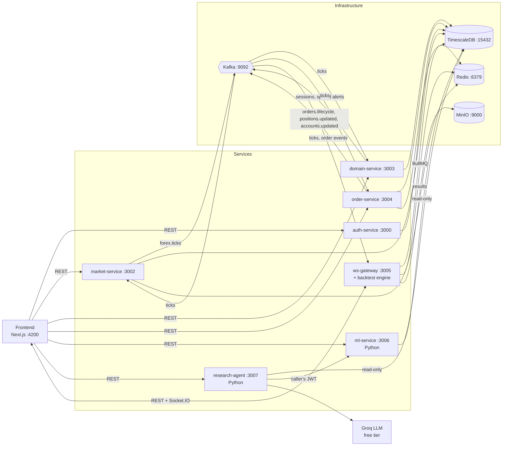

# ForexEdge

An algorithmic forex trading platform built as an Nx monorepo: NestJS microservices over Kafka, a Next.js
trading terminal, a backtester on 13 years of real minute data, a walk-forward LSTM evaluation and a
research agent that answers questions about the platform's own data.

> **Paper trading only. Not financial advice.** Orders are filled by a simulated broker
> (`PaperBrokerAdapter`); no real money is involved. Backtest, model and research results are historical
> analysis, not signals to buy or sell.

## Architecture



All backend services use the global prefix `/api` and run from the repo root, which holds the only `.env`.

| Service | Port | Responsibility |
|---|---|---|
| auth-service | 3000 | Register/login, JWT access and refresh tokens (refresh token in an httpOnly cookie), Argon2 hashing. Owns every DB migration and seed. |
| market-service | 3002 | Tick ingestion (mock stream for now), publishes `forex.ticks`, writes ticks to TimescaleDB and Redis, serves candles and instruments (live and `?source=historical`). |
| domain-service | 3003 | Forex domain logic: pip value, margin, swaps, session clock, spread monitor, economic calendar. |
| order-service | 3004 | Orders, positions and account on a paper broker; validates orders against live ticks, spread and market hours; stop-loss/take-profit and stop-out; publishes order, position and account events. |
| ws-gateway | 3005 | Socket.IO gateway relaying ticks and per-user order/position/account events. Also hosts the backtest engine (BullMQ queue and worker, results in MinIO). |
| ml-service | 3006 | Python FastAPI, inference only: walk-forward LSTM next-hour direction models; evaluation and historical test predictions over a JWT API. Read-only DB login. |
| research-agent | 3007 | Python FastAPI + LangGraph agent over an MCP server of 7 read-only tools; every number in an answer is checked by a deterministic verifier. Read-only DB login. |
| frontend | 4200 | Next.js trading terminal, backtesting, economic calendar, model evaluation and research pages. |

Infrastructure (`infra/docker-compose.yml`): TimescaleDB on host port 15432, Redis 6379, Kafka (KRaft) 9092,
MinIO 9000 (console 9001), Prometheus 9090, Grafana 3001.

## Tech stack

- **Backend:** NestJS 11, TypeScript 5.9, TypeORM 0.3, KafkaJS, BullMQ, Socket.IO, ioredis, Argon2.
- **Frontend:** Next.js 16, React 19, Redux Toolkit + RTK Query, Tailwind CSS 3, Radix UI, lightweight-charts 5.
- **Data:** TimescaleDB 2.27 (PostgreSQL 16) with continuous aggregates, Redis 7.4, Kafka 4.2 (KRaft), MinIO.
- **ML:** Python 3.12, PyTorch 2.14, FastAPI, psycopg 3.
- **Research agent:** LangGraph, LangChain, MCP (FastMCP over stdio), langchain-mcp-adapters, Groq via `init_chat_model`.
- **Tooling:** Nx 22 (npm workspaces), Jest 30, Testing Library, ruff, mypy `--strict`, pytest; Python dependencies
  pinned and hash-locked.

## Highlights

### Real historical data
- **19,187,987** real Dukascopy one-minute bid/ask bars for EUR/USD, GBP/USD, USD/JPY and XAU/USD, 2010-2022,
  exported with Dukascopy's official JForex strategy API.
- Stored as exact integer points in TimescaleDB (compressed 7.5x), with M5/M15/H1 (UTC) and H4/D1 (New York close)
  continuous aggregates.
- Validated by `npm run data:validate`: FRED noon New York fixings agree to a median of 0.40-1.60 pips in every
  pair-year, and three documented gold extremes agree to within $2.30.

### A backtester reproduced to the cent
- Backtests run only on the imported history, fill at the next bar's open on the real bid/ask, and report money in
  USD with marked-to-market equity, drawdown and a daily New York-close Sharpe.
- `npm run backtest:verify` submits runs through the real API and reproduces each one from the raw M1 table in
  independent SQL, without the backtester's code.
- MA crossover 10/30 on H1, 2022: **every trade and every metric match exactly**, with money compared in cents:
  - EUR/USD: 257 trades, net -272.20 USD;
  - XAU/USD: 217 trades, net -555.92 USD;
  - USD/JPY: 215 trades, net +1,485.75 USD.

### An honest LSTM walk-forward evaluation
- Next-hour direction LSTMs per pair, with 7 expanding walk-forward folds (test years 2016-2022). Features use past
  bars only, and scaling uses training-period statistics only.
- The decision rule was fixed before training: pooled McNemar tests with a Holm correction across 16
  pair-baseline comparisons.
- **Result:** pooled accuracy is 51.63-51.84%.
  - The LSTM beats 9 of the 16 comparisons, all of them against the logistic, majority or persistence
    baselines.
  - It **does not beat the anti-persistence baseline for any pair**.
  - It is **below the spread break-even accuracy for all four pairs** (53.24-60.18%), so it would not cover the
    spread.
- The service and the frontend present these results as a historical test, not live signals.

### A research agent with a deterministic verifier
- A LangGraph agent answers questions about ForexEdge's own data only: the history, the caller's backtest runs and
  the ML evaluation.
- Its 7 read-only tools are served by an MCP server, one stdio process per request. The answer must be a
  structured report.
- **No unverified numbers.** A verifier with no LLM checks every number against a unit-suffixed field of a real
  tool result: prices at the pair's decimals, percentages with at least 3 significant digits, counts and USD
  exact, signed. If verification fails after one retry, the response is "could not verify" and the unverified
  text is never shown.
- **Least privilege.** The agent uses its own read-only DB login, with column-level SELECT on backtest runs, and
  every backtest query filters by the caller's user id. ml-service is called with the caller's own token.
- **Budgets.** Every request has limits on tool calls, model calls, output tokens and wall clock.
- **Live eval:** 10 questions with independently computed expectations; a wrong report type counts as a failure.

  | Run | Pass | Notes |
  |---|---|---|
  | 1 | 8/10 | Both failures came from the eval's own number check (float64 noise), not the agent |
  | 2 | 9/10 | After fixing only that check: one real agent miss (it gave the open and close instead of the return) |
  | 3 | 9/10 | After a prompt rule for returns: that miss passes; one question ended "could not verify" on a provider HTTP 400 |

## Getting started

### Prerequisites
- **Windows with Git Bash.** The Python targets call `.venv\Scripts\python.exe`. Use Git Bash, not PowerShell.
- **Docker Desktop** (WSL2 backend); start it before `docker compose`.
- **Node.js 24+** and npm.
- **Python 3.12** (the `py -3.12` launcher), for ml-service and research-agent.

### 1. Install and configure
```sh
npm install
cp .env.example .env        # then replace every change-me with your own values
```
`.env` lives in the repo root and is the only one. Nx loads it into every task, and every service reads it from
the repo root. Never commit it.

### 2. Start the infrastructure
```sh
docker compose -f infra/docker-compose.yml --env-file .env up -d
```
TimescaleDB listens on host port **15432**, so it doesn't clash with a local PostgreSQL.

### 3. Create the schema
```sh
npm run migration:run
npm run seed:instruments
```

### 4. Import the historical data (not included in the repo)
The market data is not in the repo: the source CSVs are about 2.3 GB, and `data/` is gitignored. To import it:
1. Export the one-minute bid/ask bars with the JForex strategy in `tools/market-data/jforex/`. Its README covers
   the free Dukascopy demo account, compiling the strategy and calibration runs.
2. Copy the exported `forexedge-m1` folder to `data/raw/jforex/`.
3. Import and check:
```sh
npm run data:import -- --years 2010-2022   # or one year / --pairs EURUSD,XAUUSD / --dry-run; idempotent
npm run data:import -- --check-only        # rerun the import checks on the data already loaded
npm run data:validate                      # compare with FRED fixings and gold extremes
```

### 5. Start the services
On a low-resource machine, compiled mode is lighter than several `nx serve` watchers:
```sh
npx nx build auth-service && node dist/apps/auth-service/main.js        # likewise market-, domain-, order-service, ws-gateway
# or, with watchers:
npx nx serve auth-service

npx nx dev frontend                                  # http://localhost:4200
# production build of the frontend:
npx nx build frontend && npx nx run frontend:serve:production
```

The Python services:
```sh
npx nx setup ml-service                              # venv + hash-checked install
npx ts-node --transpile-only tools/ops/create-ml-db-user.ts         # read-only login from ML_DB_USER / ML_DB_PASS
npx nx serve ml-service                              # :3006 (the trained models are in the repo)

npx nx setup research-agent
npx ts-node --transpile-only tools/ops/create-research-db-user.ts   # read-only login from RESEARCH_DB_USER / RESEARCH_DB_PASS
npx nx serve research-agent                          # :3007, needs GROQ_API_KEY for live answers
```

### 6. Demo users
`tools/ops/research-demo-data.ts` creates the demo users `research_demo` and `research_demo_2` (regular users,
not admins) and gives them verified backtest runs. Their passwords come from `RESEARCH_DEMO_PASS` and
`RESEARCH_DEMO_2_PASS` in your `.env`. auth-service and ws-gateway must be running.
```sh
npx ts-node --transpile-only tools/ops/research-demo-data.ts
```
You can also register your own user on the frontend's register page.

## Common commands

```sh
# Lint, typecheck, test and build what a change affects
npx nx affected -t lint typecheck test build --parallel=2

# Single project / single file
npx nx test order-service
npx nx test order-service --testFile=order.service.spec.ts
npx nx run-many -t lint typecheck test -p ml-service,research-agent

# Full clean matrix (end of a roadmap step)
npx nx reset && rm -rf dist && npx nx run-many -t lint typecheck test build --parallel=2

# DB integration tests run in <DB_NAME>_test, created and migrated per run
RUN_DB_TESTS=true npx nx test market-data-import --skip-nx-cache
RUN_DB_TESTS=true npx nx test order-service --skip-nx-cache
RUN_DB_TESTS=true npx nx test ml-service
RUN_DB_TESTS=true RUN_LIVE_ML=true npx nx test research-agent      # ml-service running

# Independent backtest verification (auth-service and ws-gateway running)
npm run backtest:verify -- --pairs EUR_USD,XAU_USD --from 2022-01-01 --to 2022-12-30

# Research agent live eval: 10 real questions (ml-service running).
# Needs your own free Groq API key in GROQ_API_KEY; it uses that key's free-tier quota.
npx nx run research-agent:eval
```

The default test suites never call an LLM: agent tests replay recorded real transcripts.

## Status and roadmap

| Step | Status |
|---|---|
| 1. Health check: infra, all projects build and serve, paper trading end to end | Done |
| 2. Historical data: Dukascopy M1 import, aggregates, validation | Done |
| 3. Backtest verification: USD money, metrics, independent SQL reproduction | Done |
| 4. ML service: walk-forward LSTM evaluation, read-only API and page | Done |
| 5. Research agent: LangGraph + MCP, deterministic verifier, live eval | Done |
| 5b. Research page in the frontend | Done (manual browser check pending) |
| 6. Real market data: a live feed behind `USE_MOCK_DATA` | Next |
| 7. Deployment on free tiers | Planned |

Until step 6, the live feed is a mock stream (`USE_MOCK_DATA=true`). The backtester, the ML evaluation and the
research agent use only the real imported history.

## Disclaimer

ForexEdge is a portfolio project for paper trading and research. It places no real orders and is not
investment, financial or trading advice. Past performance in backtests or model evaluations does not indicate
future results. The historical data comes from Dukascopy; check Dukascopy's terms of use before redistributing
it or serving it publicly.

All rights reserved — no license is granted to use, copy or modify this code.
