# ForexEdge

ForexEdge is an algorithmic forex trading platform built as an Nx monorepo: NestJS microservices over Kafka, a
Next.js trading terminal, a backtester and a bar-by-bar replay on 13 years of real minute data (both reproduced
to the cent by independent checks), a walk-forward LSTM evaluation that reports its weak result honestly, and a
research agent whose every number is checked by a deterministic verifier. It runs on AWS behind Caddy, built
with Terraform and deployed by GitHub Actions with automatic rollback.

[](https://youtu.be/Q_-vPWzzyYE)

Live: https://forexedge.tech (demo login on request via LinkedIn: https://www.linkedin.com/in/aakash-devkar)

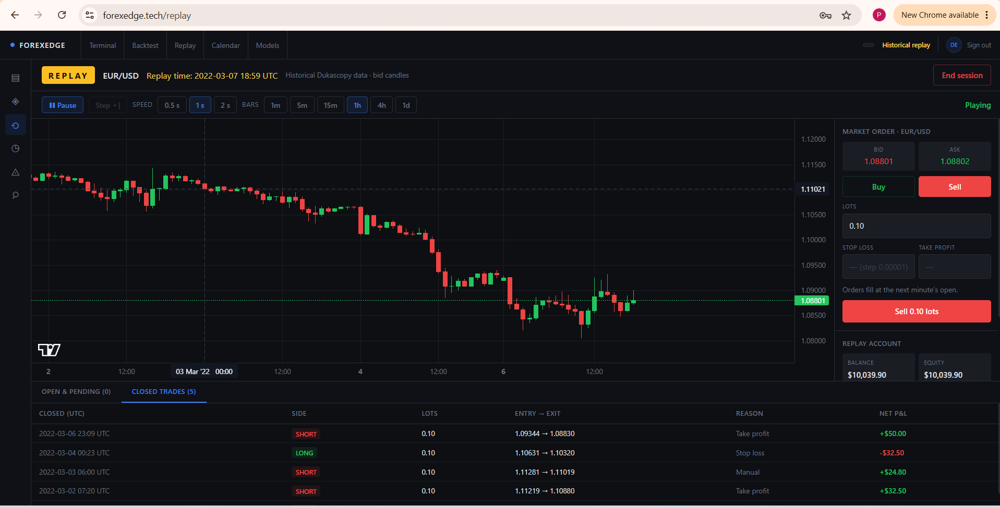

> **Paper trading only. Not financial advice.** Orders are filled by a simulated broker
> (`PaperBrokerAdapter`); no real money is involved. Backtest, model and research results are historical
> analysis, not signals to buy or sell.

## Architecture

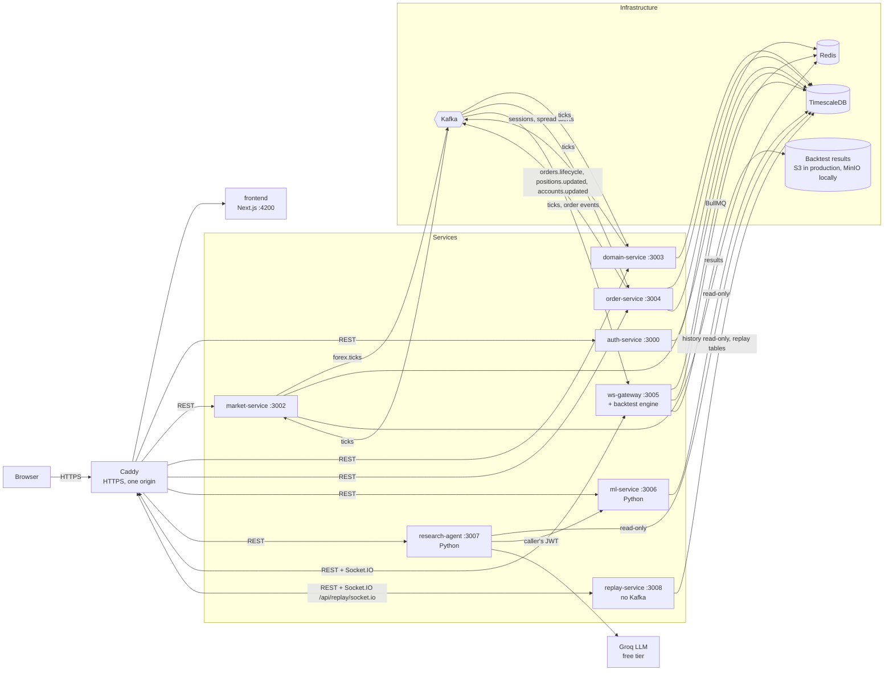

In production Caddy serves everything on one HTTPS origin and routes each path prefix to its service
(`infra/caddy/Caddyfile`); in development `next dev`'s rewrites do the same. All backend services use the global
prefix `/api`, answer `/health/live` and `/health/ready`, and run from the repo root, which holds the only `.env`.

| Service | Port | Responsibility |
|---|---|---|
| auth-service | 3000 | Register/login, JWT access and refresh tokens (refresh token in an httpOnly cookie), Argon2 hashing. Owns every DB migration and seed. |
| market-service | 3002 | Live feed per `MARKET_FEED` (no feed by default; `mock` = simulated prices for development, always labelled), publishes `forex.ticks`, reports the feed's state, writes ticks to TimescaleDB and Redis, serves candles and instruments (live and `?source=historical`). |
| domain-service | 3003 | Forex domain logic: pip value, margin, swaps, session clock, spread monitor, and an events-only economic calendar (FOMC and ECB from their official calendars, other events via Forex Factory). |
| order-service | 3004 | Orders, positions and account on a paper broker; validates orders against live ticks, spread and market hours; stop-loss/take-profit and stop-out; publishes order, position and account events. |
| ws-gateway | 3005 | Socket.IO gateway relaying ticks and per-user order/position/account events. Also hosts the backtest engine (BullMQ queue and worker; results in S3 in production, MinIO locally). |
| ml-service | 3006 | Python FastAPI, inference only: walk-forward LSTM next-hour direction models; evaluation and historical test predictions over a JWT API. Read-only DB login. |
| research-agent | 3007 | Python FastAPI + LangGraph agent over an MCP server of 7 read-only tools; every number in an answer is checked by a deterministic verifier. Read-only DB login. |
| replay-service | 3008 | Bar replay over the 2010-2022 history: REST sessions and orders, Socket.IO namespace `/replay` on `/api/replay/socket.io` (play, pause, step, speed, timeframe). No Kafka, no Redis; its own DB login. |
| frontend | 4200 | Next.js trading terminal, backtesting, replay, economic calendar, model evaluation and research pages. |

Local infrastructure (`infra/docker-compose.yml`): TimescaleDB on host port 15432, Redis 6379, Kafka (KRaft)
9092, MinIO 9000 (console 9001), Prometheus 9090, Grafana 3001. The production stack
(`infra/docker-compose.prod.yml`) publishes only Caddy's ports.

## Tech stack

- **Backend:** NestJS 11, TypeScript 5.9, TypeORM 0.3, KafkaJS, BullMQ, Socket.IO, ioredis, Argon2.
- **Frontend:** Next.js 16, React 19, Redux Toolkit + RTK Query, Tailwind CSS 3, Radix UI, lightweight-charts 5.
- **Data:** TimescaleDB 2.27 (PostgreSQL 16) with continuous aggregates, Redis 7.4, Kafka 4.2 (KRaft), MinIO / S3.
- **ML:** Python 3.12, PyTorch 2.14, FastAPI, psycopg 3.
- **Research agent:** LangGraph, LangChain, MCP (FastMCP over stdio), langchain-mcp-adapters, Groq via `init_chat_model`.
- **Deployment:** Docker Compose, Caddy, Terraform 1.16.7 on AWS (EC2, ECR, S3, IAM, CloudWatch, SSM), GitHub Actions
  with OIDC.
- **Tooling:** Nx 22 (npm workspaces), Jest 30, Testing Library, Playwright, ruff, mypy `--strict`, pytest, tflint,
  shellcheck; Python dependencies pinned and hash-locked.

## Highlights

### Real historical data
- **19,187,987** real one-minute bid/ask bars for EUR/USD, GBP/USD, USD/JPY and XAU/USD, 2010-2022, exported
  from a reliable institutional market-data source through its official API.
- Stored as exact integer points in TimescaleDB (compressed 7.5x), with M5/M15/H1 (UTC) and H4/D1 (New York close)
  continuous aggregates.
- Validated by `npm run data:validate`: FRED noon New York fixings agree to a median of 0.40-1.60 pips in every
  pair-year, and three documented gold extremes agree to within $2.30.

### A backtester reproduced to the cent
- Backtests run only on the imported history, fill at the next bar's open on the real bid/ask, and report money in
  USD with marked-to-market equity, drawdown and a daily New York-close Sharpe.
- `npm run backtest:verify` submits runs through the real API and reproduces each one from the raw M1 table in
  independent SQL, without the backtester's code.
- MA crossover 10/30 on H1, 2022: **every trade and every metric match exactly**, with money compared in cents:
  - EUR/USD: 257 trades, net -272.20 USD;
  - XAU/USD: 217 trades, net -555.92 USD;
  - USD/JPY: 215 trades, net +1,485.75 USD.

### Bar replay
- Replay the 2010-2022 history bar by bar, like a chart's bar replay, and trade it on a separate replay account:
  play, pause or step at 0.5, 1 or 2 seconds per bar, on 1m to 1d bars.
- **The server owns the clock.** A session's clock is the last processed M1 minute. The current bar is rebuilt
  from the M1 minutes up to the clock, history is only completed bars, and every payload is checked so that
  nothing after the clock is ever sent: no look-ahead.
- **Next-minute fills.** An order placed at the clock fills at the next minute's open (buy at the ask, sell at the
  bid), then SL/TP are checked minute by minute, the same rule as the backtester.
- **One set of trading rules.** Fills, SL/TP exits, USD money, commission and mark to market live in
  `@forexedge/trading-sim`, a pure library on integer points shared by the backtester and replay.
- `npm run replay:verify` replays the verified backtest trades through the running service: **689 trades**
  (EUR/USD 257, XAU/USD 217, USD/JPY 215) **match to the cent**.
- replay-service runs as its own DB login, and the database itself refuses any write from it to the history tables.

### An honest LSTM walk-forward evaluation
- Next-hour direction LSTMs per pair, with 7 expanding walk-forward folds (test years 2016-2022). Features use past
  bars only, and scaling uses training-period statistics only.
- The decision rule was fixed before training: pooled McNemar tests with a Holm correction across 16
  pair-baseline comparisons.
- **Result:** pooled accuracy is 51.63-51.84%.
  - The LSTM beats 9 of the 16 comparisons, all of them against the logistic, majority or persistence
    baselines.
  - It **does not beat the anti-persistence baseline for any pair**.
  - It is **below the spread break-even accuracy for all four pairs** (53.24-60.18%), so it would not cover the
    spread.
- The service and the frontend present these results as a historical test, not live signals.

### A research agent with a deterministic verifier
- A LangGraph agent answers questions about ForexEdge's own data only: the history, the caller's backtest runs and
  the ML evaluation.
- Its 7 read-only tools are served by an MCP server, one stdio process per request. The answer must be a
  structured report.
- **No unverified numbers.** A verifier with no LLM checks every number against a unit-suffixed field of a real
  tool result: prices at the pair's decimals, percentages with at least 3 significant digits, counts and USD
  exact, signed. If verification fails after one retry, the response is "could not verify" and the unverified
  text is never shown.
- **Least privilege.** The agent uses its own read-only DB login, with column-level SELECT on backtest runs, and
  every backtest query filters by the caller's user id. ml-service is called with the caller's own token.
- **Budgets.** Every request has limits on tool calls, model calls, output tokens and wall clock.
- **Live eval:** 10 questions with independently computed expectations; a wrong report type counts as a failure.

  | Run | Pass | Notes |
  |---|---|---|
  | 1 | 8/10 | Both failures came from the eval's own number check (float64 noise), not the agent |
  | 2 | 9/10 | After fixing only that check: one real agent miss (it gave the open and close instead of the return) |
  | 3 | 9/10 | After a prompt rule for returns: that miss passes; one question ended "could not verify" on a provider HTTP 400 |

### Deployment and CI/CD
- **Terraform on AWS** (`infra/terraform`, ap-south-1): one EC2 t3.medium (IMDSv2 only, encrypted root volume, no
  key pair), ECR repositories with immutable tags and scan on push, private S3 buckets for backtest results and
  backups (public access blocked, encrypted, TLS only), least-privilege IAM roles for the host and for deploys,
  CloudWatch alarms (CPU, CPU credits, status check, memory, disk) by email, and daily root-volume snapshots.
- **No SSH.** The security group opens only HTTP and HTTPS; the host is reached through SSM (Session Manager and
  Run Command), and nothing sent through SSM ever carries a secret.
- **CI on every pull request** (`ci.yml`, the required check `ci`): lint, typecheck, test and build of the affected
  Node projects, ruff, mypy and pytest for the affected Python services, and the offline infrastructure checks.
- **CD on every push to main** (`deploy.yml`): GitHub Actions assumes the deploy role through OIDC (no stored AWS
  keys), builds and pushes the images to ECR, and `deploy.sh` takes a pre-deploy database dump, runs
  backward-compatible migrations, switches the release and checks every service's readiness. A failed check
  **rolls back to the previous release automatically**, proven by a rollback drill (`simulate_failure`).
- **Instance metadata guard:** IMDSv2 with hop limit 2 plus an iptables rule, so only ws-gateway (which needs the
  role's S3 credentials) can reach the metadata service; every other container is refused.
- **Backups you can restore:** pre-deploy dumps are self-contained, and `restore-test.sh` restores the newest one
  into a scratch database and compares its row counts with the live ones.
- **Checks that are checked:** `npm run infra:check` runs fmt, validate, a mocked `terraform test`, tflint and
  shellcheck offline, and `planted-faults.sh` plants a fault for every rule: **143 caught, 0 missed**.

Runbook: [docs/DEPLOY.md](docs/DEPLOY.md).

## Screenshots

| | |
|---|---|
| 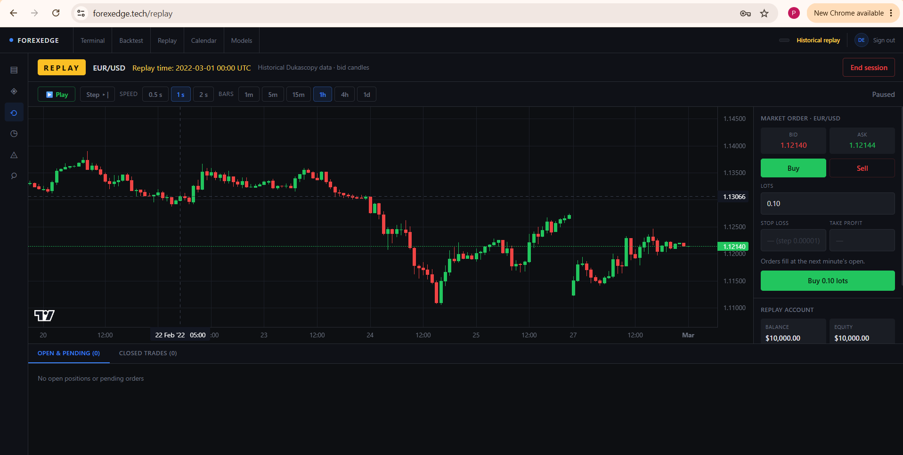 |  |
| Replay paused at 2022-03-01 00:00 UTC: EUR/USD H1 bid candles, the order panel and a $10,000 replay account. | Replay playing at 2022-03-07 18:59 UTC: closed trades with take-profit, stop-loss and manual exits and their net P&L. |
| 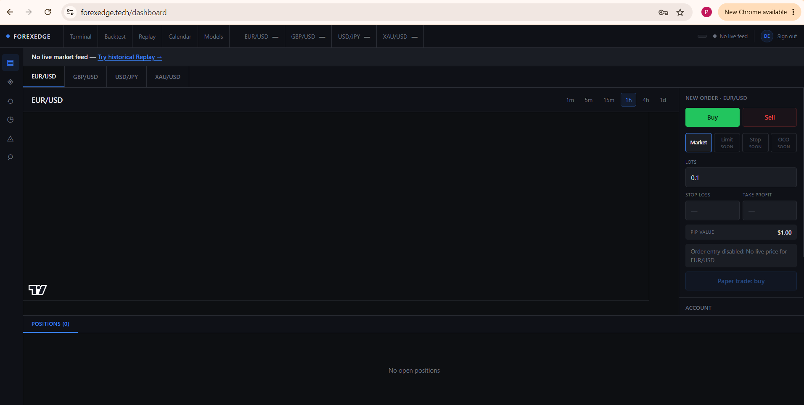 | 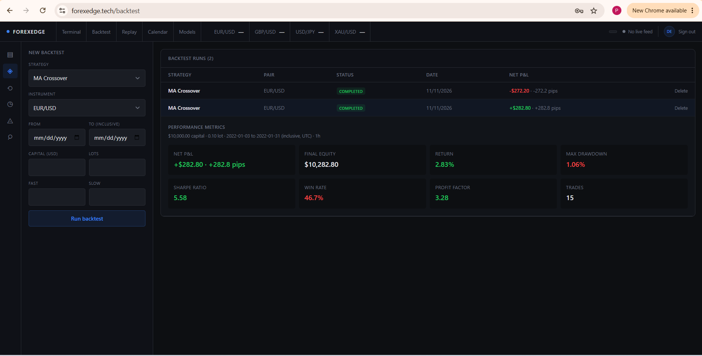 |
| The trading terminal with no live feed: order entry is disabled and a banner links to the historical replay. | An MA crossover backtest on EUR/USD H1, 2022-01-03 to 2022-01-31: 15 trades, +$282.80, max drawdown 1.06%. |
| 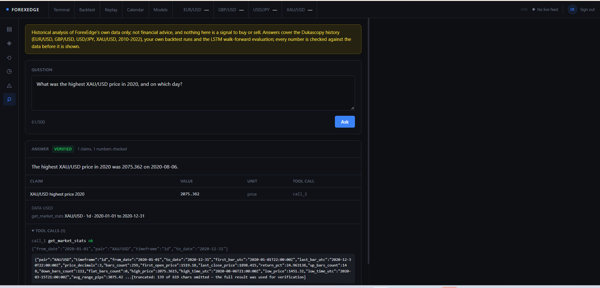 | 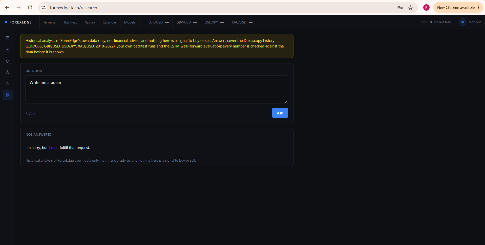 |
| A VERIFIED research answer (the 2020 XAU/USD high) with its claim, the data used and the tool call. | An off-topic question ("Write me a poem") is not answered. |
| 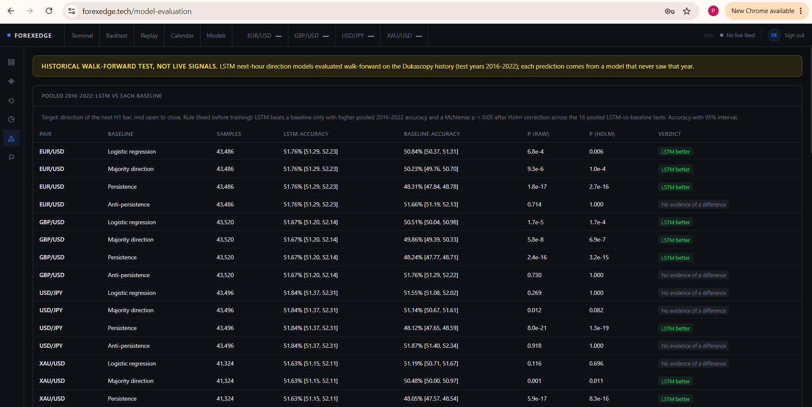 | 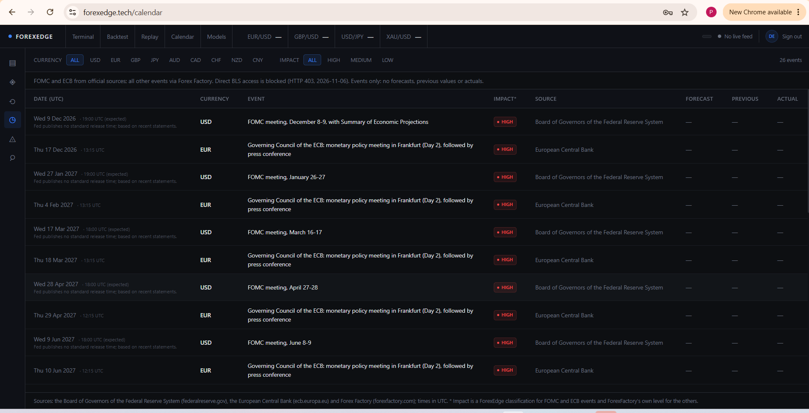 |
| Model evaluation: pooled 2016-2022 LSTM accuracy against each baseline, with raw and Holm p-values and the verdict. | The economic calendar: upcoming FOMC and ECB meetings in UTC, with impact and source. |

### Infrastructure

| | |
|---|---|
| 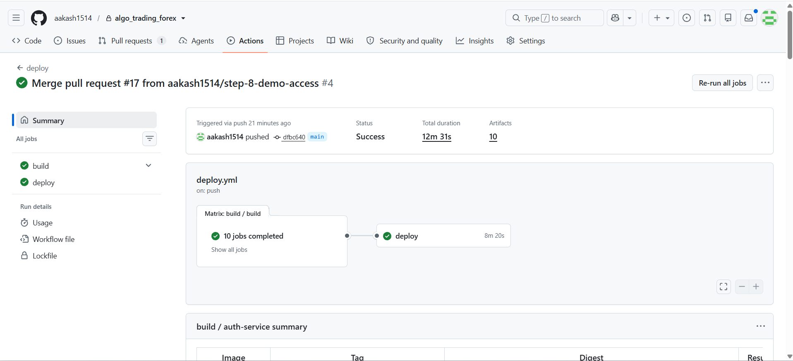 | 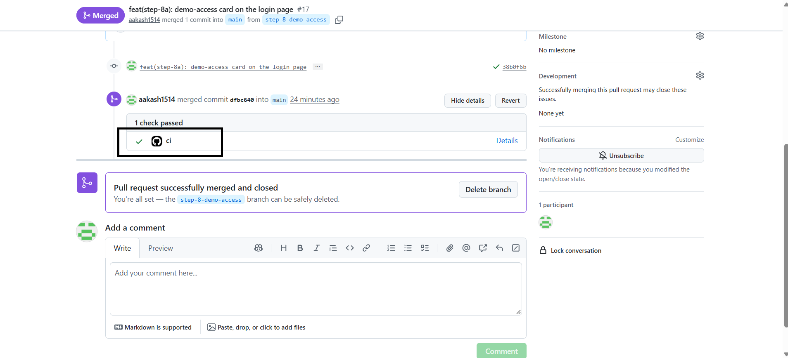 |
| A `deploy.yml` run for a push to main: 10 image builds, then the deploy job; success in 12m 31s. | A merged pull request with its required `ci` check passed. |
| 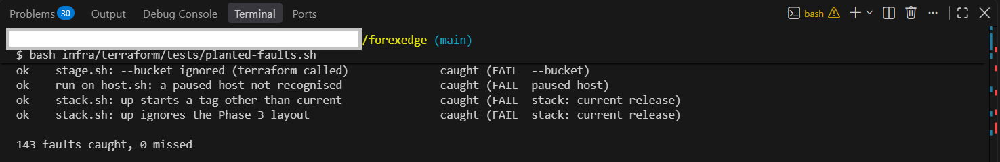 | 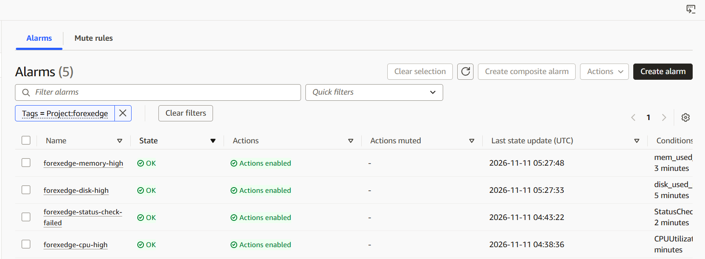 |
| The end of a `planted-faults.sh` run: 143 faults caught, 0 missed. | The project's CloudWatch alarms (memory, disk, status check and CPU shown), all OK. |
| 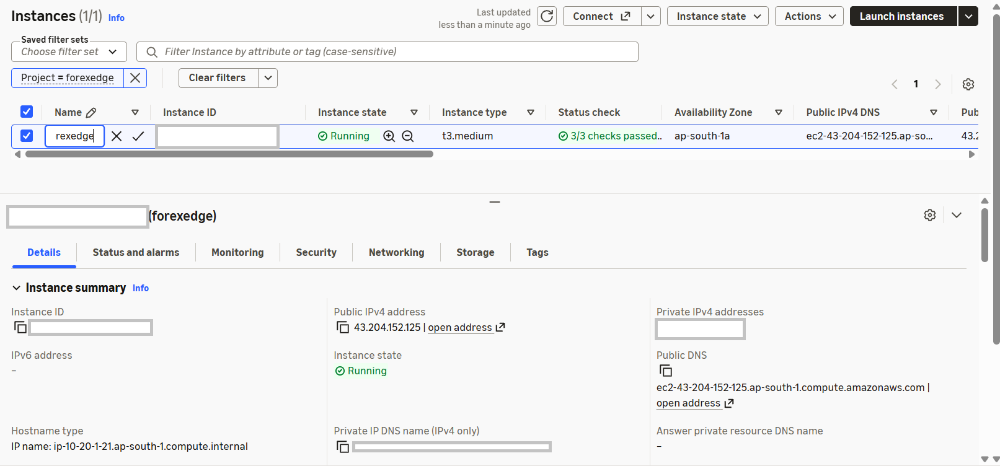 | 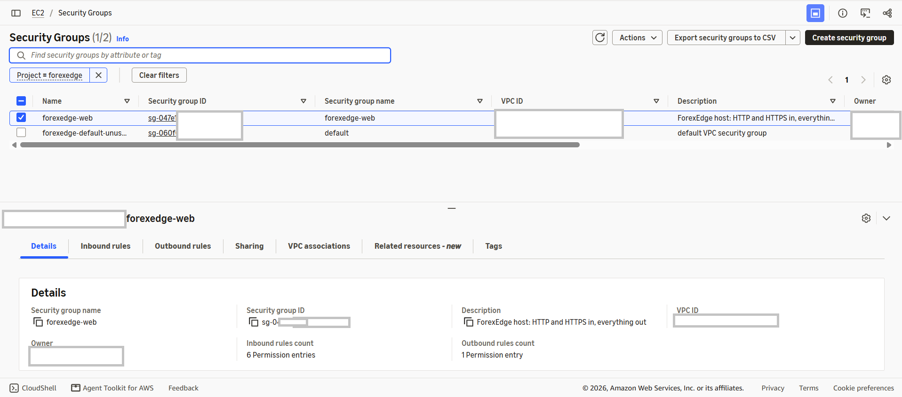 |
| The t3.medium host in ap-south-1a: running, 3/3 status checks passed. | The details of the `forexedge-web` security group: "HTTP and HTTPS in, everything out". |
| 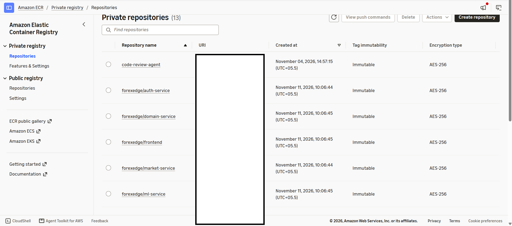 | 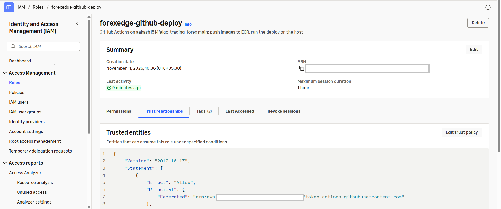 |
| ECR private repositories (`forexedge/<service>`) with immutable tags and AES-256 encryption. | The `forexedge-github-deploy` role and the start of its trust policy (GitHub's OIDC provider). |

## Getting started

### Prerequisites
- **Windows with Git Bash.** The Python targets call `.venv\Scripts\python.exe`. Use Git Bash, not PowerShell.
- **Docker Desktop** (WSL2 backend); start it before `docker compose`.
- **Node.js 24+** and npm.
- **Python 3.12** (the `py -3.12` launcher), for ml-service and research-agent.

### 1. Install and configure
```sh
npm install
cp .env.example .env        # then replace every change-me with your own values
```
`.env` lives in the repo root and is the only one. Nx loads it into every task, and every service reads it from
the repo root. Never commit it.

### 2. Start the infrastructure
```sh
docker compose -f infra/docker-compose.yml --env-file .env up -d
```
TimescaleDB listens on host port **15432**, so it doesn't clash with a local PostgreSQL.

### 3. Create the schema
```sh
npm run migration:run
npm run seed:instruments
```

### 4. Import the historical data (not included in the repo)
The market data is not in the repo: the source CSVs are about 2.3 GB, and `data/` is gitignored. To import it:
1. Export the one-minute bid/ask bars with the exporter in `tools/market-data/`; its README covers the account,
   the export and calibration runs.
2. Copy the exported folder to the import folder that `tools/market-data/import` reads.
3. Import and check:
```sh
npm run data:import -- --years 2010-2022   # or one year / --pairs EURUSD,XAUUSD / --dry-run; idempotent
npm run data:import -- --check-only        # rerun the import checks on the data already loaded
npm run data:validate                      # compare with FRED fixings and gold extremes
```

### 5. Start the services
On a low-resource machine, compiled mode is lighter than several `nx serve` watchers:
```sh
npx nx build auth-service && node dist/apps/auth-service/main.js        # likewise market-, domain-, order-service, ws-gateway
# or, with watchers:
npx nx serve auth-service

npx nx dev frontend                                  # http://localhost:4200
# production build of the frontend:
npx nx build frontend && npx nx run frontend:serve:production
```

replay-service (:3008) runs as its own DB login:
```sh
npx ts-node --transpile-only tools/ops/create-replay-db-user.ts     # login from REPLAY_DB_USER / REPLAY_DB_PASS
npx nx build replay-service && node dist/apps/replay-service/main.js
```

The Python services:
```sh
npx nx setup ml-service                              # venv + hash-checked install
npx ts-node --transpile-only tools/ops/create-ml-db-user.ts         # read-only login from ML_DB_USER / ML_DB_PASS
npx nx serve ml-service                              # :3006 (the trained models are in the repo)

npx nx setup research-agent
npx ts-node --transpile-only tools/ops/create-research-db-user.ts   # read-only login from RESEARCH_DB_USER / RESEARCH_DB_PASS
npx nx serve research-agent                          # :3007, needs GROQ_API_KEY for live answers
```

### 6. Demo users
`tools/ops/research-demo-data.ts` creates the demo users `research_demo` and `research_demo_2` (regular users,
not admins) and gives them verified backtest runs. Their passwords come from `RESEARCH_DEMO_PASS` and
`RESEARCH_DEMO_2_PASS` in your `.env`. auth-service and ws-gateway must be running.
```sh
npx ts-node --transpile-only tools/ops/research-demo-data.ts
```
Registration is closed unless `REGISTRATION_ENABLED=true`. `.env.example` sets it for development, so locally you
can also register your own user on the frontend's register page.

## Common commands

```sh
# Lint, typecheck, test and build what a change affects
npx nx affected -t lint typecheck test build --parallel=2

# Single project / single file
npx nx test order-service
npx nx test order-service --testFile=order.service.spec.ts
npx nx run-many -t lint typecheck test -p ml-service,research-agent

# Full clean matrix (end of a roadmap step)
npx nx reset && rm -rf dist && npx nx run-many -t lint typecheck test build --parallel=2

# DB integration tests run in <DB_NAME>_test, created and migrated per run
RUN_DB_TESTS=true npx nx test market-data-import --skip-nx-cache
RUN_DB_TESTS=true npx nx test order-service --skip-nx-cache
RUN_DB_TESTS=true npx nx test replay-service --skip-nx-cache
RUN_DB_TESTS=true npx nx test ml-service
RUN_DB_TESTS=true RUN_LIVE_ML=true npx nx test research-agent      # ml-service running

# Independent backtest verification (auth-service and ws-gateway running)
npm run backtest:verify -- --pairs EUR_USD,XAU_USD --from 2022-01-01 --to 2022-12-30

# Replay equivalence: the verified backtest trades through replay-service (auth-service and replay-service running)
npm run replay:verify

# Infrastructure checks, offline (no AWS call)
npm run infra:check
bash infra/terraform/tests/planted-faults.sh

# Research agent live eval: 10 real questions (ml-service running).
# Needs your own free Groq API key in GROQ_API_KEY; it uses that key's free-tier quota.
npx nx run research-agent:eval
```

The default test suites never call an LLM: agent tests replay recorded real transcripts.

## Status and roadmap

| Step | Status |
|---|---|
| 1. Health check: infra, all projects build and serve, paper trading end to end | Done |
| 2. Historical data: M1 import, aggregates, validation | Done |
| 3. Backtest verification: USD money, metrics, independent SQL reproduction | Done |
| 4. ML service: walk-forward LSTM evaluation, read-only API and page | Done |
| 5. Research agent: LangGraph + MCP, deterministic verifier, live eval | Done |
| 5b. Research page in the frontend | Done (manual browser check pending) |
| 6a. Price safety (price age/source checks, no feed by default, SIMULATED/STALE states) and an official events calendar | Done |
| 6b. Historical bar replay: replay-service and the Replay page | Done |
| 7. AWS deployment (Terraform, EC2, ECR, S3) and CI/CD, live at https://forexedge.tech | Done |
| 8. Portfolio polish (demo access, README, demo video) | In progress |

There is no licensed live price feed. The feed is set by `MARKET_FEED=none|mock`: `none` is the default (no
prices are published and the terminal disables order entry), and `mock` is a simulated feed for development,
marked "SIMULATED PRICES — not market data" everywhere it appears. Any other value fails startup. The backtester,
the replay, the ML evaluation and the research agent use only the real imported history.

## Disclaimer

ForexEdge is a portfolio project for paper trading and research. It places no real orders and is not
investment, financial or trading advice. Past performance in backtests or model evaluations does not indicate
future results. The historical data comes from a third-party data provider; check its terms of use before
redistributing it or serving it publicly.

All rights reserved — no license is granted to use, copy or modify this code.
